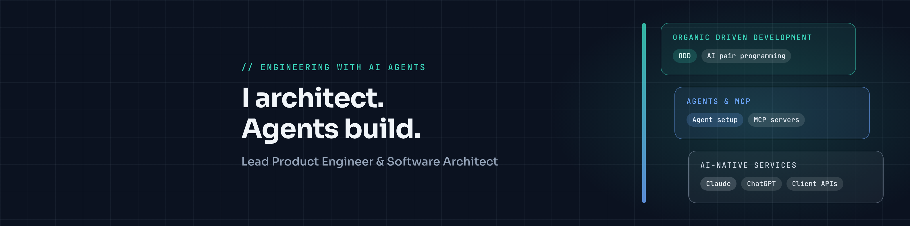
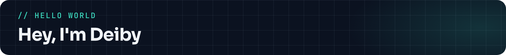
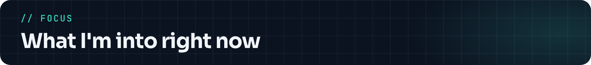
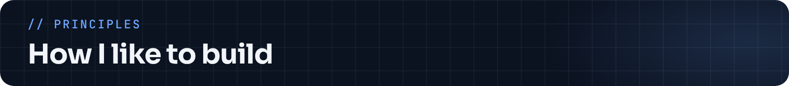
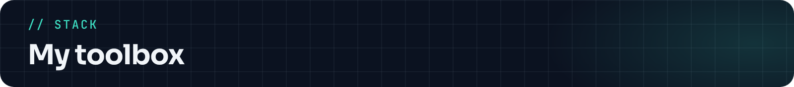
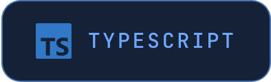
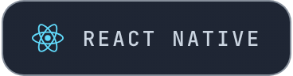
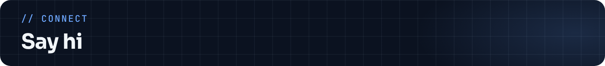
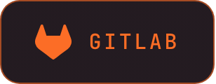

I architect software and set up the AI agents that build it. Every day I pair with Claude and other AI tools: they write the code, I own the architecture, the constraints, and the decisions.

I'm also building services that live where people already work: APIs and tools that clients connect to their own Claude or ChatGPT subscription, so they can use our product straight from the chat.

- 🤝 **Organic Driven Development (ODD)**: pair programming with AI agents where the process emerges from the work. Small change? Just do it. Uncertain? Research first. Substantial? Add structure. The idea comes from [Gentle AI](https://github.com/Gentleman-Programming/gentle-ai) by Alan Buscaglia (Gentleman Programming), and this is how I apply it
- 🧩 **Agents & MCP**: configuring agents and building MCP servers that connect apps and APIs to AI
- 🔌 **AI-native services**: shipping APIs that clients use directly from Claude or ChatGPT with their own subscription
- 🧱 **Architecture**: Clean Architecture, BFF layers, and DDD, the part I care about most

- Architecture first, agents write the code
- Humans make the decisions, agents do the typing
- Structure that emerges with the work, not before it
- Clear contracts between frontend, backend, and agents

TypeScript and React are home base for me.

Also in the mix:

I'm always up for talking about software architecture, AI agents, MCP, or frontend systems.

📍 Colombia
