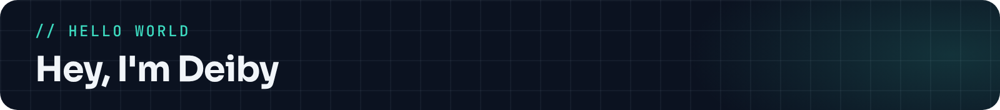
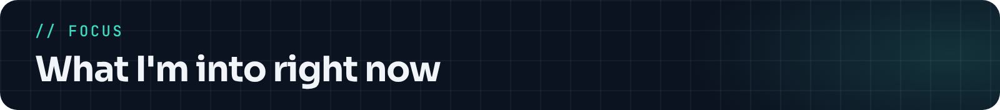
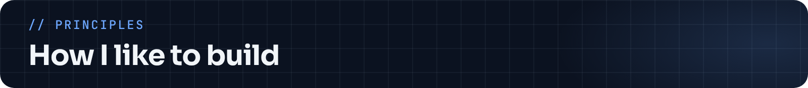
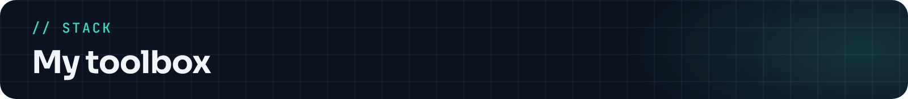
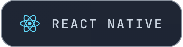
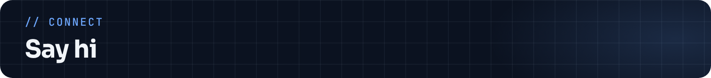

I design the systems that let software get built fast, and lately, the ones that let **AI agents build it with us**.

I started out writing frontend and mobile code. Over time I got more interested in what sits around the code: the architecture, the data contracts, and the middleware that decide whether a team moves fast or gets stuck.

- 🤖 **AI-agent development workflows**: figuring out how engineering teams can plug autonomous agents into their pipelines without losing control of quality
- 📐 **Spec-Driven Development**: when the spec is solid, humans and agents can both build from it
- 🧱 **Clean Architecture & BFF layers**: shaping complex APIs into the exact data a React, Svelte, or Vue app needs
- 🗺️ **Domain-Driven Design**: keeping software aligned with the problem it solves

- Architecture first, code second
- Clear contracts between frontend, backend, and agents
- Fewer surprises, faster delivery

TypeScript and React are home base for me.

Also in the mix:

I'm always up for talking about software architecture, AI-assisted engineering, or frontend systems.

📍 Colombia
